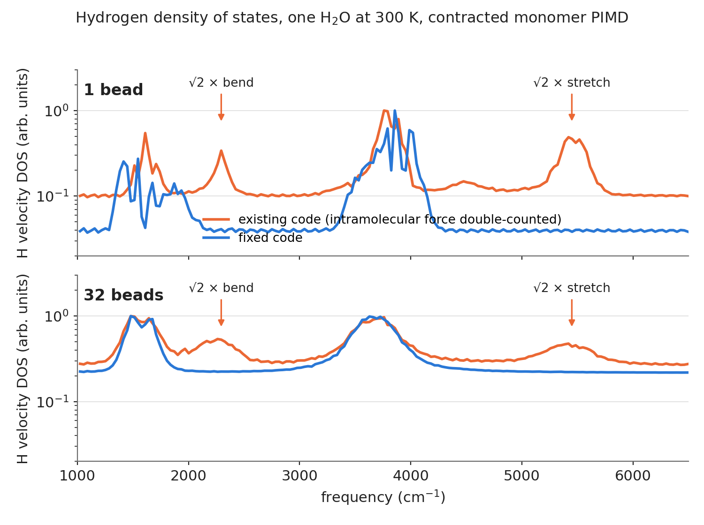

# Fast and accurate *ab-initio* Path Integral Molecular Dynamics in Fortran 90

2015-2017 Daniel C. Elton

PIMD-F90 implements path integral molecular dynamics (PIMD) to capture the nuclear quantum effects in water.

# Current status:

'''The code is currently broken! Those interested doing PIMD are encouraged to look at the [i-PI Python package](http://ipi-code.org/) instead.'''

We received a request to remove the TTM / SPC force calculation routines. Those routines were publicly available on [Google code](https://code.google.com/archive/p/nqcbabel/) in the "nqcbabel" repository under /nqcbabel/trunk/extra/ttm-ice and clearly had a [GNU GPL v3](https://www.gnu.org/licenses/gpl.html) license associated with them. We were told this licensing was a mistake however and agreed to comply with the request to remove them.  

The code should still work with SIESTA but needs to be fixed to remove references to the TTM and SPC forcefield routines:
(potential.f90, consts.f90, find_neigh.f90, pot_mod.f90, pot_ttm.f90, smear.f90 math.f90 ewald.f90 nasa.f90 nasa_mod.f90)

TTM3-F ref: George S. Fanourgakis and Sotiris S. Xantheas, J. Chem. Phys. 128, 074506 (2008)  
TTM2-F ref: J. Phys. Chem. A. vol 110, page 4100-4106, (2006)  

## Bug fix (November 2026): double-counted intramolecular force in contracted (monomer) PIMD with SIESTA

The DOS of the contracted / monomer-PIMD runs with SIESTA in the 2019 PCCP paper (Figs. 11-12) showed
unexplained extra peaks at ~2250 and ~5250-5500 cm^-1. These sit at exactly sqrt(2) x bend and sqrt(2) x stretch
of the single molecule (1611 -> 2294 and 3922 -> 5550 cm^-1): the intramolecular force constant was counted twice.

Cause: in `contracted_MD` (MD.f90) the Partridge-Schwenke (PS) monomer force is applied on every bead and the SIESTA
force is applied at the centroid. The TTM potentials skip their own monomer term when `CONTRACTION` is set
(pot_ttm.f90) but the SIESTA path had no equivalent, and the monomer-corrected SIESTA returns the *full* potential
`E_DFT + E_PS - E_fit`, so the PS force entered twice. In the vdW-cx runs only part of the molecules were affected
because `PBCs` wrapped atoms one at a time: ~20% of the molecules were split across the box edge at any instant, the
fit energy evaluated by SIESTA on those raw coordinates exceeded its 2.5 eV cutoff, and the correction was switched
off for them, leaving DFT + PS (doubled) for those molecules only. Hence a weak sqrt(2) ghost peak instead of a shifted
spectrum.

Changes:

* `MD.f90`: new `remove_centroid_monomer_term` subtracts the PS energy/force (and virial) evaluated at the centroid from
  the slow force for SIESTA runs, so that `V_slow(c) = V_SIESTA(c) - V_PS(c)`. With the monomer-corrected SIESTA this is
  exactly the intermolecular part `E_DFT - E_fit`, and with one bead the scheme reduces to classical MD on the SIESTA
  potential. Applied in `contracted_MD` and in the deprecated `monomer_PIMD`.
* `main_stuff.f90`: `PBCs` now wraps whole molecules (shift decided by the oxygen centroid, applied to O, H, H and all
  their beads) so molecules handed to SIESTA are never split. New `make_molecules_whole` is applied to input coordinates
  and loaded checkpoints (`InputOutput.f90`) to repair files written by the old per-atom wrapping.
* `force_calc.f90`: the SIESTA branch of `potential` now sets the (unavailable) virials to zero instead of leaving them
  undefined.

Requirements on the SIESTA side: SIESTA must return the complete potential it is asked for (plain DFT, or DFT with the
monomer correction `E_DFT + E_PS - E_fit`). Do **not** pair this code with a `monomer_correct` that returns
`E_DFT - E_fit` only; the PS term would then be removed twice. Note also that in the modified SIESTA sources used for the
paper, the `pot_nasa_pbe_DZP` and `pot_nasa_bh_DZP` fit routines dated July 2016 and later carry an offset constant with
the wrong sign (minimum energy +5.58 / +4.62 eV instead of 0), which permanently trips the 2.5 eV gate and disables the
correction. Fix that constant before using those fits.

Verification: with a mock SIESTA that returns the PS monomer potential for isolated molecules
(`tests/mock_siesta_contraction/`), the old code gives H-DOS peaks at ~2230 and ~5580 cm^-1 for one bead (and 15-25% of
the molecules arrive at SIESTA split across the box edge), the fixed code gives ~1610 and ~3900 cm^-1 and no split
molecules; with 32 beads the fixed code shows no sqrt(2) ghost peaks.

The figure below shows the effect with the same integrator and the TTM3-F potential standing in for DFT. The orange
curves emulate the old behaviour (intramolecular force double-counted whenever the molecule straddles the box edge),
the blue curves are the fixed code. The arrows mark sqrt(2) x bend and sqrt(2) x stretch.

## License information

All files written by D. C. Elton include the MIT open source license in their header.

Additional files taken from open source codebases are as follows:

### fsiesta_pipes.f90
This file is taken from the [SIESTA package](https://departments.icmab.es/leem/siesta/) which is licensed under the GNU GPL v3 open source license ([link](https://launchpad.net/siesta)).

## SIESTA
The PIMD code can obtain forces & energies from the density functional theory package [SIESTA](http://departments.icmab.es/leem/siesta/).
It uses unix pipes to communicate with SIESTA. A working flush() routine is required for this (see pflush.f90).

## Features
* Parallelization over the beads with MPI
* Options for a global Nose-Hoover thermostat or Anderson barostat
* virial energy and pressure estimators
* many output options
* Choice of Langevin or Nose-Hoover bead thermostats
* Option to not thermostat the centroid
* Option to perform the PIMD on the monomer only (a subcase of the ring polymer contraction scheme ref: [JCP 129, 024105 (2008)](http://dx.doi.org/10.1063/1.2953308) )
* implementation of custom PES for using the "monomer PIMD" method with DFT
* By changing the adiabaticity parameter (ficticious mass rescaling) the code can also implement Centroid Molecular Dynamics (CMD) and Ring Polymer Molecular Dynamics (RPMD).

## Compilation
currently compiles with openMPI (gcc) mpif90 compiler or Intel mpiifort. However SIESTA functionality doesnt work with mpiifort

other notes: i
compiles with openmpi/gcc/64/1.8.5 but not mvapich/gcc/64/1.2rc1

SIESTA compiles with mvapich but not openmpi

## Input file specification
See the example input file input128.inp for program options

See [manual/PIMD_manual.pdf](manual/PIMD_manual.pdf)

## Acknowledging

If you use this code, please cite our publication:

D. C. Elton, M. Fritz, and M.-V Fernández-Serra. "[Using a monomer potential energy surface to perform approximate path integral molecular dynamics simulation of ab-initio water at near-zero added cost](https://pubs.rsc.org/en/Content/ArticleLanding/2019/CP/C8CP06077K#!divAbstract)", *Phys. Chem. Chem. Phys.*, **21**, 409 (2019) [[arXiv](https://arxiv.org/abs/1803.05740)]

Here is a bibTex entry for it:

@article{Elton2019,  
  doi = {10.1039/c8cp06077k},  
  url = {https://doi.org/10.1039/c8cp06077k},  
  year  = {2019},  
  publisher = {Royal Society of Chemistry ({RSC})},  
  volume = {21},  
  number = {1},  
  pages = {409--417},  
  author = {Daniel C. Elton and Michelle Fritz and Marivi Fern{\'{a}}ndez-Serra},  
  title = {Using a monomer potential energy surface to perform approximate path integral molecular dynamics simulation of ab initio water at near-zero added cost},  
  journal = {Physical Chemistry Chemical Physics}  
}
